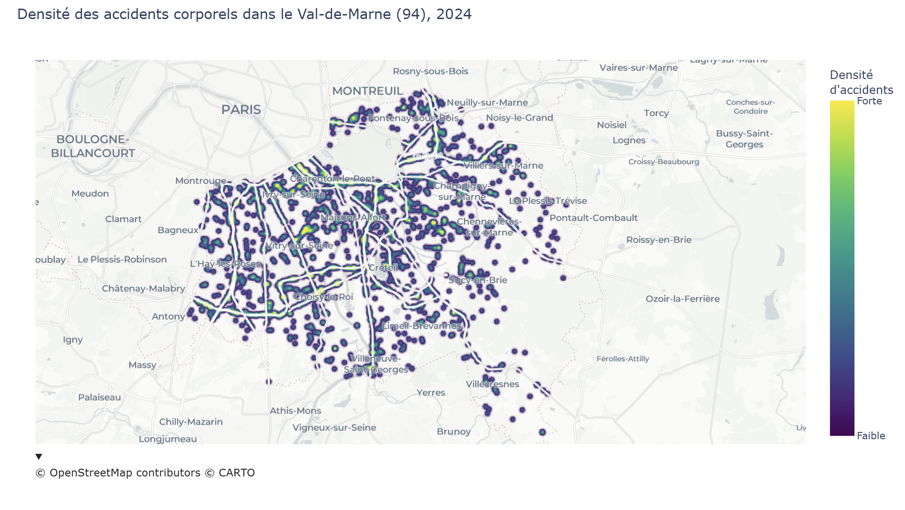
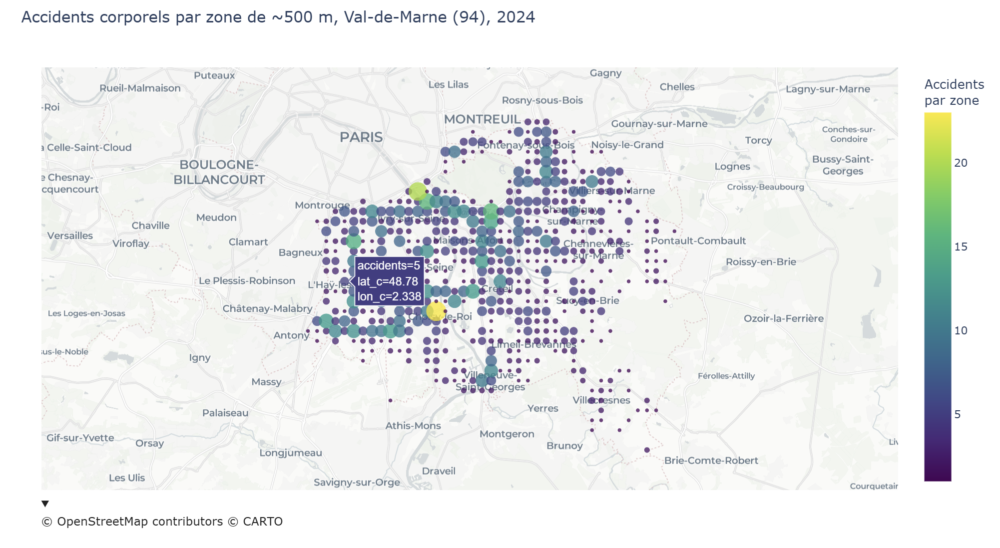
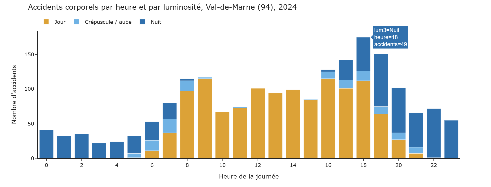

## Partie 1 - Lisibilité des visualisations

Étudie des règles 7 à 16 

### Règle 7 – Étiquettes et graduations lisibles

- Problème identifié :

Des graduations trop nombreuses, une police trop petite ou des étiquettes mal orientées peuvent rendre un graphique difficile à lire. Le lecteur doit alors faire un effort supplémentaire pour comprendre les informations présentées.

- Comment corriger ce problème ?

Il est préférable de limiter le nombre de graduations, d'utiliser une taille de police suffisamment grande et de privilégier des étiquettes horizontales lorsque cela est possible.

- Application dans mon projet :

Sur mon graphique représentant les accidents selon l'heure de la journée, j'ai choisi d'afficher une graduation toutes les deux heures plutôt que toutes les heures. Les titres des axes sont explicites et la légende est placée horizontalement au-dessus du graphique.


### Règle 8 – Accessibilité des couleurs

- Problème identifié :

L'utilisation d'un trop grand nombre de couleurs ou de teintes trop proches peut compliquer la distinction entre les différentes catégories. Cela peut également poser des problèmes aux personnes daltoniennes ou lors de l'impression des graphiques.

- Comment corriger ce problème ?

Il faut privilégier des palettes limitées, suffisamment contrastées et adaptées aux différents types de perception des couleurs.

- Application dans mon projet :

J'ai utilisé la palette Viridis pour les cartes, qui permet de représenter les variations de densité de manière progressive.

Pour le graphique par heure et luminosité, j'ai choisi trois couleurs distinctes issues de la palette Okabe-Ito : orange pour le jour, bleu clair pour le crépuscule et l'aube, et bleu foncé pour la nuit.


### Règle 9 – Étiquetage direct

- Problème identifié :

Une légende trop éloignée du graphique oblige le lecteur à effectuer des allers-retours visuels entre les données et les catégories correspondantes.

- Comment corriger ce problème ?

Il est préférable d'indiquer directement le nom des séries ou des catégories à proximité des données, plutôt que de renvoyer systématiquement vers une légende séparée.

- Application dans mon projet :

Mon graphique par heure comporte trois séries correspondant aux différentes conditions de luminosité. J'ai choisi de conserver une légende horizontale, positionnée juste au-dessus du graphique, afin qu'elle reste immédiatement accessible.

Je n'ai pas utilisé d'étiquetage directement sur les barres, car cela aurait risqué de surcharger le graphique empilé.


### Règle 10 – Éviter le chartjunk

- Problème identifié :

Les effets décoratifs inutiles, comme les ombres, les bordures trop marquées, les effets 3D ou les grilles trop présentes, peuvent détourner l'attention des informations importantes.

- Comment corriger ce problème ?

Il faut privilégier une présentation simple et supprimer les éléments qui n'apportent aucune information supplémentaire.

- Application dans mon projet :

J'ai choisi un fond de carte clair et sobre pour mes visualisations géographiques. Pour le graphique en barres, j'ai utilisé le thème simple_white de Plotly afin de mettre l'accent sur les données plutôt que sur la décoration.


### Règle 11 – Limiter le nombre de catégories

- Problème identifié :

Un graphique contenant trop de catégories peut devenir difficile à interpréter. Le lecteur doit alors mémoriser un grand nombre de couleurs ou d'étiquettes pour comprendre les informations.

- Comment corriger ce problème ?

Regrouper certaines catégories, de filtrer les données ou de créer plusieurs graphiques lorsque cela améliore la compréhension.

- Application dans mon projet :

La variable de luminosité contient cinq modalités. Pour faciliter la lecture, je les ai regroupées en trois catégories :
- jour
- crépuscule / aube
- nuit

Ce regroupement permet de conserver une information pertinente tout en simplifiant le graphique.


### Règle 12 – Trier les barres catégorielles

- Problème identifié :

Les catégories ne suivent aucun ordre particulier, leur présentation dans un ordre arbitraire peut rendre les comparaisons difficiles.

- Comment corriger ce problème ?

Classer les catégories par ordre croissant ou décroissant selon leur valeur, sauf lorsqu'un ordre logique ou naturel existe déjà.

- Application dans mon projet :

Sur mon graphique, l'axe horizontal représente les heures de la journée. J'ai volontairement conservé l'ordre chronologique de 0 h à 23 h plutôt que de classer les heures selon le nombre d'accidents.


### Règle 13 – Éviter la surimpression dans les nuages de points

- Problème identifié :

De nombreux points sont représentés sur une même zone, ils peuvent se chevaucher et masquer certaines informations. Il devient alors difficile de distinguer les concentrations et les répartitions géographiques.

- Comment corriger ce problème ?

Utiliser de la transparence, décaler légèrement les points, regrouper les observations ou utiliser une représentation par densité.

- Application dans mon projet :

Avec 1 963 accidents recensés dans un territoire relativement restreint, une représentation de chaque accident sous forme de point aurait entraîné de nombreux chevauchements. J'ai donc choisi deux approches complémentaires : une carte de densité et une carte regroupant les accidents par zones d'environ 500 mètres.


### Règle 14 – Éviter une précision décimale excessive

- Problème identifié :

Afficher trop de décimales peut compliquer la lecture et donner une impression de précision qui n'est pas forcément justifiée par les données.

- Comment corriger ce problème ?

Il faut adapter le niveau de précision à l'information présentée et éviter les chiffres inutiles.

- Application dans mon projet :

Sur la carte par zone, les nombres d'accidents sont présentés sous forme d'entiers. Pour la carte de densité, j'ai remplacé l'échelle numérique initiale allant de 0 à 1 par des indications plus compréhensibles : « Faible » et « Forte ».


### Règle 15 – Formatage des informations temporelles

- Problème identifié :

Les graphiques temporels peuvent rapidement devenir difficiles à lire lorsque les étiquettes sont trop nombreuses ou trop longues.

- Comment corriger ce problème ?

Réduire le nombre de graduations, utiliser des formats courts et conserver les étiquettes horizontales lorsque cela est possible.

- Application dans mon projet :

Sur mon graphique représentant les accidents par heure, j'ai choisi d'afficher une graduation toutes les deux heures. Les étiquettes restent horizontales afin de faciliter la lecture de l'axe temporel.


### Règle 16 – Économie visuelle

- Problème identifié :

Vouloir afficher trop d'informations dans un même graphique peut disperser l'attention du lecteur et rendre le message principal moins évident.

- Comment corriger ce problème ?

Simplifier les visualisations et de donner à chaque graphique un objectif précis.

- Application dans mon projet :

J'ai séparé mon analyse en deux grandes questions :

Où se produisent les accidents ? Les cartes permettent d'étudier leur répartition géographique.

Quand se produisent les accidents ? Le graphique en barres permet d'étudier leur répartition selon l'heure et la luminosité.

Chaque visualisation possède ainsi un objectif clairement défini.


## Partie 2 – Cartographie des accidents corporels

### 2.1 Données et périmètre
 
- **Source** : base des accidents corporels de la circulation routière (ministère de l'Intérieur / ONISR) sur data.gouv.fr, Licence Ouverte.
- **Périmètre** : année **2024**, département du **Val-de-Marne (94)**. Un territoire restreint rend la carte lisible, tout en gardant assez d'accidents pour observer des concentrations. Sur la France entière (plus de 50 000 accidents), la carte serait illisible.
- **Fichier utilisé** : `caract-2024.csv` (date, heure, luminosité, département, coordonnées GPS). Les fichiers Lieux, Véhicules et Usagers ne sont pas nécessaires ici.
- **Variables retenues** : `Num_Acc` (identifiant), `lat` et `long` (cartes), `dep` (filtre), `hrmn` (heure), `lum` (luminosité).


### 2.2 Nettoyage
 
```python
import pandas as pd
 
df = pd.read_csv("caracteristiques-2024.csv", sep=";", dtype={"dep": str}, low_memory=False)
 
# Coordonnées avec virgule décimale : conversion en nombres
df["lat"] = pd.to_numeric(df["lat"].str.replace(",", "."), errors="coerce")
df["long"] = pd.to_numeric(df["long"].str.replace(",", "."), errors="coerce")
 
# France métropolitaine, puis Val-de-Marne
df_metro = df[df["lat"].between(41, 52) & df["long"].between(-5.5, 10)]
d = df_metro[df_metro["dep"] == "94"].copy()
 
# Variables dérivées
d["heure"] = d["hrmn"].str[:2].astype(int)
d["lum3"] = d["lum"].map({1: "Jour", 2: "Crépuscule / aube", 3: "Nuit", 4: "Nuit", 5: "Nuit"})
```
 
**Contrôles effectués**
- Fichier initial : 54 402 accidents, 15 colonnes.
- Aucune valeur manquante ni coordonnée égale à 0.
- 3 347 accidents hors métropole (outre-mer) écartés : il reste 51 055 accidents.
- Après filtrage sur le 94 : **1 963 accidents**, avec des coordonnées cohérentes (latitude 48,70 à 48,86 et longitude 2,31 à 2,59).
- Aucun doublon sur `Num_Acc`, heures bien comprises entre 0 et 23.


### 2.3 Première visualisation : où ont lieu les accidents ?
 
J'ai réalisé deux cartes complémentaires.
 
**A. Carte de densité**
 
```python
import plotly.express as px
 
fig = px.density_map(
    d, lat="lat", lon="long", radius=4, zoom=10,
    center={"lat": d["lat"].mean() - 0.01, "lon": d["long"].mean()},
    map_style="carto-positron", color_continuous_scale="Viridis",
    title="Densité des accidents corporels dans le Val-de-Marne (94), 2024", height=650,
)
fig.update_layout(coloraxis_colorbar=dict(
    title="Densité<br>d'accidents", tickvals=[0, 1], ticktext=["Faible", "Forte"]))
fig.show()
```


 
Plus la couleur est claire, plus les accidents sont concentrés. Cette carte donne une vue d'ensemble et met en évidence des alignements le long de grands axes routiers.


**B. Carte par zones d'environ 500 m**
 
```python
g = d.copy()
g["lat_c"] = (g["lat"] / 0.005).round() * 0.005
g["lon_c"] = (g["long"] / 0.007).round() * 0.007
cells = g.groupby(["lat_c", "lon_c"]).size().reset_index(name="accidents")
 
fig = px.scatter_map(
    cells, lat="lat_c", lon="lon_c", color="accidents", size="accidents",
    size_max=14, opacity=0.75, zoom=10,
    center={"lat": d["lat"].mean() - 0.01, "lon": d["long"].mean()},
    map_style="carto-positron", color_continuous_scale="Viridis",
    title="Accidents corporels par zone de ~500 m, Val-de-Marne (94), 2024", height=650,
)
fig.update_layout(coloraxis_colorbar_title="Accidents<br>par zone")
fig.show()
```
 

 
Chaque point représente une zone d'environ 500 m ; sa taille et sa couleur indiquent le nombre d'accidents, ce qui permet de comparer des effectifs réels.
 
**Pourquoi deux cartes ?** La carte de densité montre la structure d'ensemble mais sa légende est relative. La carte par zones offre une légende chiffrée. Elles se complètent.


### 2.4 Seconde visualisation : quand ont lieu les accidents ?
 
J'ai choisi de comparer les accidents selon **l'heure** et la **luminosité**, avec un diagramme en barres empilées.
 
```python
par_heure = d.groupby(["heure", "lum3"]).size().reset_index(name="accidents")
 
fig_h = px.bar(
    par_heure, x="heure", y="accidents", color="lum3",
    category_orders={"lum3": ["Jour", "Crépuscule / aube", "Nuit"]},
    color_discrete_map={"Jour": "#E69F00", "Crépuscule / aube": "#56B4E9", "Nuit": "#0072B2"},
    title="Accidents corporels par heure et par luminosité, Val-de-Marne (94), 2024", height=480,
)
fig_h.update_xaxes(dtick=2, title="Heure de la journée")
fig_h.update_yaxes(title="Nombre d'accidents")
fig_h.update_layout(template="simple_white", legend_title_text="",
                    legend=dict(orientation="h", y=1.12, x=0))
fig_h.show()
```




| Luminosité | Accidents | Part |
|---|---|---|
| Jour | 1 206 | 61 % |
| Nuit | 630 | 32 % |
| Crépuscule / aube | 127 | 6 % |
| **Total** | **1 963** | **100 %** |
