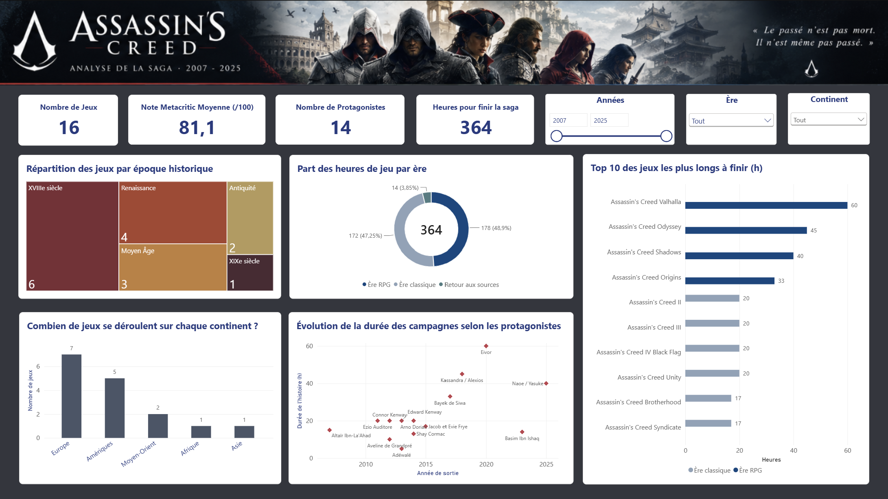

## Assassin's Creed : analyse de la saga (2007-2025)

Projet individuel de visualisation de données réalisé avec Power BI, dans le cadre d’un travail sur le thème des jeux vidéo.

### Aperçu du dashboard

### Description du projet

Ce dashboard interactif analyse la saga Assassin’s Creed à travers une sélection de 16 jeux sortis entre 2007 et 2025. L’objectif est d’étudier l’évolution de la franchise au fil des années, notamment en matière de durée de jeu, d’univers historiques et de personnages.

Plusieurs visualisations permettent d’explorer les périodes historiques représentées, la répartition des jeux par continent, la durée des campagnes et leur évolution selon les protagonistes. Des indicateurs clés (KPI) synthétisent également les principales informations de la sélection.

Des filtres interactifs permettent d’affiner l’analyse selon l’année de sortie, l’ère de gameplay et le continent. Le dashboard utilise différents types de graphiques afin de faciliter les comparaisons et de mettre en évidence les tendances de la saga.

### Analyse des graphiques

- Indicateurs clés (KPI) : donnent une vue d’ensemble des principales données de la sélection.
- Treemap des périodes historiques : permet de comparer les époques représentées et d’identifier les plus présentes dans les jeux étudiés.
- Graphique circulaire des heures de jeu par ère : montre la répartition du temps de jeu estimé entre les différentes ères de la saga.
- Top 10 des jeux les plus longs : compare les durées des campagnes principales et met en évidence les jeux les plus longs.
- Répartition par continent : illustre la diversité géographique des lieux représentés dans la franchise.
- Nuage de points sur les protagonistes : permet d’observer l’évolution des durées de campagne selon les personnages et les années de sortie.

### Outils et sources

- Outil : Power BI
- Ubisoft : informations officielles sur les jeux.
- Metacritic : notes de la presse.
- HowLongToBeat : estimations des durées de jeu.
- Wikipédia : informations historiques complémentaires.
