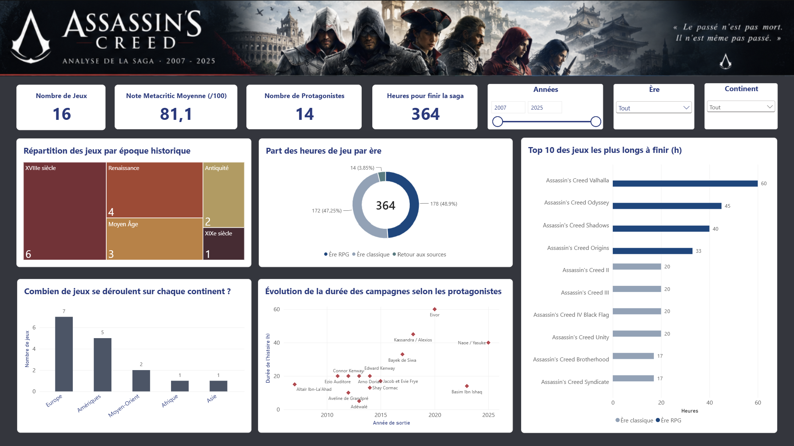

## Assassin's Creed : analyse de la saga (2007-2025)

Projet individuel de visualisation de données réalisé avec Power BI, dans le cadre d’un travail sur le thème des jeux vidéo.

### Aperçu du dashboard

### Description du projet

Ce dashboard interactif analyse la saga Assassin’s Creed à travers une sélection de 16 jeux sortis entre 2007 et 2025. L’objectif est d’étudier l’évolution de la franchise au fil des années, notamment en matière de durée de jeu, d’univers historiques et de personnages.

Plusieurs visualisations permettent d’explorer les périodes historiques représentées, la répartition des jeux par continent, la durée des campagnes et leur évolution selon les protagonistes. Des indicateurs clés (KPI) synthétisent également les principales informations de la sélection.

Des filtres interactifs permettent d’affiner l’analyse selon l’année de sortie, l’ère de gameplay et le continent. Le dashboard utilise différents types de graphiques afin de faciliter les comparaisons et de mettre en évidence les tendances de la saga.

### Outils et sources de données

- Outil de visualisation : Power BI
- Données étudiées : années de sortie, notes de la presse, durées de jeu, périodes historiques, continents et protagonistes.
- Sources : **Ubisoft** pour les informations officielles sur la saga, **Metacritic** pour les notes de la presse et **HowLongToBeat** pour les durées de jeu. **Wikipédia** a également été utilisé comme source complémentaire pour certaines informations historiques.
